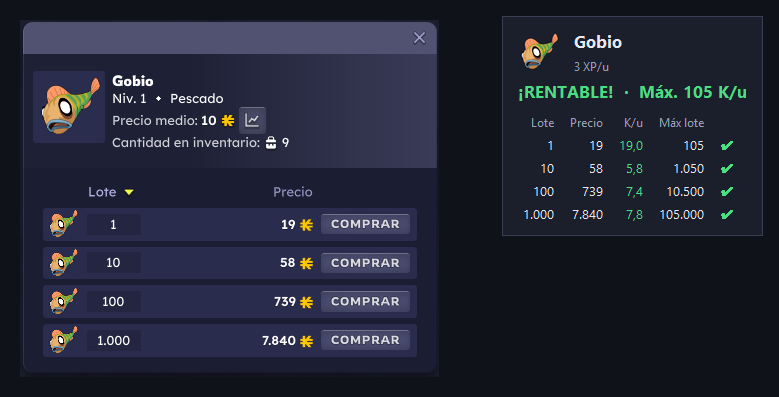
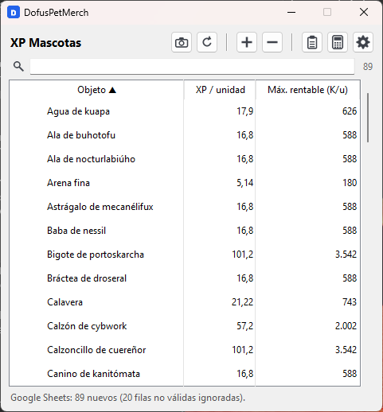
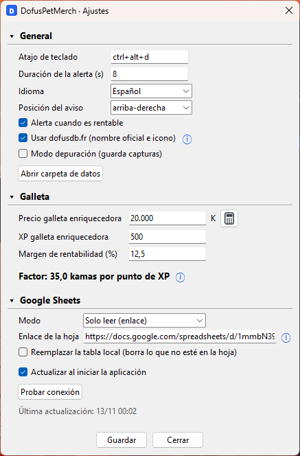
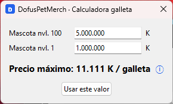

# DofusPetMerch

Aplicación de escritorio ligera para Windows que, **al pulsar un atajo de teclado**, lee la ventana de compra del mercadillo de Dofus (nombre del objeto, icono y precio de cada lote) y te avisa de si comprar ese objeto para alimentar mascotas es más rentable que la *Galleta enriquecedora*.

- **Pasiva.** Solo hace una captura de pantalla y le pasa OCR. No lee la memoria del juego, no se inyecta en él y no le envía teclas ni clics. Sí enumera las ventanas para encontrar la de Dofus por su título y su rectángulo.
- **Sin sondeo.** Solo actúa cuando pulsas el atajo, así que en reposo usa 0 % de CPU (unos 57 MB de RAM).
- **OCR integrado en Windows** (`Windows.Media.Ocr`). No hace falta Tesseract ni ninguna descarga pesada.
- **[dofusdb.fr](https://dofusdb.fr)** es opcional. Aporta el nombre oficial, el icono y los nombres en 5 idiomas, y guarda una caché local.

## Descarga

**[⬇ Descargar DofusPetMerch.exe](https://github.com/ptruebadev-oss/DofusPetMerch/releases/latest/download/DofusPetMerch.exe)** (última versión, Windows 10 u 11).

Es un único archivo: no se instala ni necesita nada más. Guárdalo donde quieras y ábrelo con doble clic.

La primera vez, Windows puede mostrar *"Windows protegió su PC"* porque el programa no está firmado digitalmente. Pulsa **Más información > Ejecutar de todas formas**.

## Cómo se ve

Al pulsar el atajo con la ventana de compra abierta, aparece un aviso junto a ella con el veredicto y el detalle de cada lote:

<p align="center"></p>

<sub>Montaje con la captura de prueba de <code>tests/fixtures</code>; la XP del Gobio es un valor de ejemplo.</sub>

<table>
<tr>
<td align="center" valign="top"><br><sub>Tabla XP de mascotas (leída de Google Sheets)</sub></td>
<td align="center" valign="top"><br><sub>Ajustes</sub></td>
</tr>
<tr>
<td align="center" colspan="2"><br><sub>Calculadora de la galleta</sub></td>
</tr>
</table>

## Uso

1. Ejecuta `DofusPetMerch.exe` (o `python run.py`).
2. En el juego, abre la ventana de compra de un objeto en el mercadillo.
3. Pulsa **Ctrl+Alt+D** (es configurable). En menos de un segundo aparece un aviso sobre la ventana del juego con esto:
   - El icono y el nombre del objeto.
   - **¡RENTABLE! / No rentable** y el **precio máximo rentable por unidad**.
   - Una tabla con el precio, el precio por unidad y el máximo rentable de cada lote, marcando cada uno con ✔ o ✘.
   - Un sonido, si hay algún lote rentable.

El aviso es transparente a los clics y desaparece solo a los pocos segundos.

También puedes pulsar el botón de la **cámara**: la pantalla se congela y se oscurece, y arrastras un rectángulo alrededor de la ventana de compra (como con Win+Shift+S). Esc o el botón derecho cancelan.

### Tabla XP de mascotas
La ventana principal es la **tabla XP de mascotas**. Los ajustes se abren con el botón **⚙** y están agrupados en secciones plegables (*General*, *Galleta*, *Google Sheets*) con un único botón **Guardar**. Si hay algún valor no válido, no se guarda nada y se indica qué corregir.

En la tabla se indica la XP que da **una unidad** de cada objeto. dofusdb no publica este dato, así que lo mantienes tú.

Botones de la barra superior, en tres grupos (cámara y recargar | + y − | copiar, calculadora y ⚙):
- **+** abre la ventana *Añadir* (nombre y XP por unidad). Si el objeto ya está en la tabla, se actualiza. Hacer doble clic en una fila abre la misma ventana como *Actualizar*.
- En esa ventana, la **flecha hacia arriba** junto a *Objeto* rellena el último objeto leído (y su XP, si ya está en la tabla). La búsqueda ignora tildes y mayúsculas y tolera pequeños errores del OCR.
- **−** elimina las filas seleccionadas (pide confirmación). También funciona la tecla Supr.
- **Recargar** vuelve a leer la tabla: desde Google Sheets si está configurado, o si no desde `pet_xp.json`.
- **Portapapeles** copia la tabla para pegarla en una hoja de cálculo.

Encima de la tabla está el **buscador** (lupa): muestra solo los objetos cuyo nombre contiene todas las palabras escritas, sin importar mayúsculas ni tildes. Ctrl+F lo activa y Esc o la **✕** lo vacían. A la derecha se ve cuántos objetos se muestran del total.

Para **ordenar**, haz clic en la cabecera de una columna; otro clic invierte el orden (▲ / ▼).

Si el objeto no está en la tabla, el aviso muestra igualmente los precios y te pide que añadas su XP.

Cada fila muestra el icono del objeto:
- el icono oficial de dofusdb, si está activado;
- si no, el que se recortó de la pantalla la última vez que se leyó el objeto.

### Tabla XP en Google Sheets
Para pasar la tabla a una hoja a mano, pulsa el botón del **portapapeles** en la ventana principal y pega con Ctrl+V en la celda A1 de la hoja. Se copian las columnas `Objeto` y `XP`, con los decimales con coma (`0,5`) para hojas en español.

En **⚙ > Google Sheets** puedes activar la lectura de la tabla desde una hoja. La fila de la *Galleta enriquecida* se ignora: es la referencia de precio, no comida.

**Solo leer (enlace).** La app descarga la tabla de una hoja con una columna de nombres y otra de XP.

Formato de la hoja:
- **La cabecera es opcional.** Se reconocen variantes como *Objeto, obj, Nombre, Item, Artículo, Recurso* para el nombre y *XP, exp, Experiencia, Experience, XP por unidad, Puntos de experiencia* para la XP, sin importar mayúsculas ni tildes.
- **Sin cabecera, o con una que no se reconoce** (por ejemplo *Cosa | Valor*), la app deduce qué columna tiene números (la XP) y cuál texto (el nombre).
- **Las columnas pueden ir en cualquier orden** y puede haber columnas extra (notas, fechas), que se ignoran.
- **Puede haber títulos o filas vacías encima** de la cabecera, dentro de las 5 primeras filas.
- **Un objeto que se llame como una cabecera** (por ejemplo *Exp*) se lee como dato, porque su XP es un número.
- **Si hay varias columnas con números y ninguna cabecera dice cuál es la XP** (por ejemplo *Precio* y *Valor*), la app no adivina: avisa y pide que pongas una cabecera *Objeto* / *XP*.
- Las fechas no se toman como nombres de objeto.
1. Comparte la hoja como *Cualquier persona con el enlace* con permiso de *lector*.
2. Pega el enlace en la app.

Lo que haya en la hoja manda sobre la tabla local, y las filas que solo existen en local se conservan. Si quieres borrarlas, activa **Reemplazar**. Si la hoja llega vacía, la tabla local no se toca.

Escribe la XP como un número normal (`0,5`, `3`). Con el formato de miles de Sheets, `1.500` se lee como 1500.

**Sincronizar (Apps Script) — desactivado en esta versión.** Está implementado pero oculto en la interfaz (se reactivará más adelante con `ENABLE_SHEET_SYNC` en `settings.py`). Si se activa: la app y la hoja se mantienen iguales en los dos sentidos: lo que añadas, cambies o borres en cualquiera de los dos lados llega al otro. Para que la app pueda escribir en la hoja sin pedirte tu cuenta de Google, la hoja lleva un pequeño script:
1. En la app, pulsa **Copiar código Apps Script**.
2. En tu hoja, ve a *Extensiones > Apps Script*, borra lo que haya y pega el código.
3. Cambia `TOKEN` por una palabra secreta y escribe esa misma palabra en el campo **Token** de la app.
4. En Apps Script, ve a *Implementar > Nueva implementación > Aplicación web*:
   - *Ejecutar como:* **Yo**.
   - *Quién tiene acceso:* **Cualquier usuario**.
   - Pulsa *Implementar* y autoriza el acceso.
5. Copia la URL que termina en `/exec`, pégala en la app, guarda y pulsa **Probar conexión**.

Cómo funciona la sincronización:
- Se sincroniza al iniciar la app, poco después de cada cambio en la tabla y cuando pulsas el botón de **recargar**.
- Los cambios se guardan en una pestaña `XP`. En la primera sincronización el script añade la cabecera si falta (si no hay una que reconozca, **inserta** una fila nueva encima; nunca sobrescribe tus celdas) y una columna *Actualizado* al final. Respeta el orden de tus columnas y no toca las columnas extra. Los borrados se apuntan en otra pestaña, `_borrados`.
- Si editas la misma fila en los dos lados, se queda la edición más reciente.
- Sin conexión, los cambios quedan pendientes, también si cierras la app, y se suben en la siguiente sincronización.
- Si vacías la hoja entera a mano, la app no lo toma como "borrar todo": vuelve a subir su tabla. Para borrar objetos, bórralos de uno en uno (en la hoja o en la app).
- Si cambias la URL del script, la app sube toda su tabla a la nueva hoja sin borrar nada.
- Si más adelante modificas el script, publica una versión nueva en *Implementar > Gestionar implementaciones > Editar > Nueva versión*. Si no, sigue funcionando la versión anterior.

El token se guarda sin cifrar en `config.json`. Solo evita que cualquiera que conozca la URL modifique tu hoja.

## Fórmula

```
factor (kamas por XP) = precio_galleta × (1 − margen%) / XP_galleta
                      = 20000 × 0,875 / 500 = 35 K/XP
máx. rentable por unidad = XP_del_objeto × factor
máx. rentable por lote   = máx. por unidad × tamaño del lote
lote rentable si  precio_lote ≤ máx. por lote
```

**Interpretación.** El enunciado original decía "XP del objeto / factor". Como el factor está en *kamas por XP*, el precio máximo en kamas sale de **multiplicar**. Por ejemplo, un objeto que da 10 XP sale rentable hasta 350 K por unidad.

El precio y la XP de la galleta y el margen (12,5 % por defecto) se configuran en **⚙ > Galleta**. Los números se escriben en formato español: `20.000`, `12,5`.

### Precio máximo de la galleta
El botón con icono de **calculadora** (en la barra principal, junto a ⚙, y en *Ajustes > Galleta*, junto a *Precio galleta enriquecedora*) abre una calculadora que dice hasta cuánto merece la pena pagar por una galleta. Para ello compara subir una mascota del nivel 1 al 100 a base de galletas, que son siempre 360, con comprarla ya en nivel 100:

```
precio máximo por galleta = (precio mascota nivel 100 − precio mascota nivel 1) / 360
```

Ejemplo: (5.000.000 − 1.000.000) / 360 = **11.111 K** por galleta (redondeado hacia abajo, porque es un precio máximo).

- La calculadora no resta ninguna rentabilidad. El **margen** de la sección *Galleta* ya se aplica después, al calcular el precio máximo de la comida.
- El botón **Usar este valor** pone ese valor en *Precio galleta enriquecedora* y lo guarda al momento.
- Los precios de las mascotas se recuerdan para la próxima vez.

Los importes se muestran con **K** de kamas.

## Términos de uso de Ankama
DofusPetMerch se limita a mirar la pantalla, igual que lo harías tú:
- No automatiza ninguna acción: no compra ni pulsa nada por ti.
- No modifica el cliente ni lee su memoria.
- No intercepta el tráfico de red.
- No envía entradas de teclado o ratón al juego.

Aun así, Ankama no aprueba de forma oficial las herramientas de terceros, así que **la usas bajo tu responsabilidad**. No le añadas funciones de compra automática, porque eso sí infringe los términos.

## Requisitos y consejos
- Windows 10 u 11 con el paquete de idioma de OCR del idioma del juego. En español suele venir de serie; si no, ve a *Configuración > Hora e idioma > Idioma*.
- Juega en **ventana** o **pantalla completa sin bordes**. La pantalla completa exclusiva puede devolver una captura negra.
- Si el título de tu ventana de Dofus no contiene "Dofus", cámbialo en `window_title` dentro de `%APPDATA%\dofuspetmerch\config.json` (con la app cerrada).
- Hay palabras clave para clientes en ES, FR, EN, DE y PT (COMPRAR/ACHETER/BUY...). Ajusta también el **Idioma** para OCR y dofusdb.

## Depuración
Con **Modo depuración** activado (o `--debug`), cada lectura guarda la captura, el recorte de la ventana y el resultado del OCR en `%APPDATA%\dofuspetmerch\debug\`.

Comandos útiles:

```
DofusPetMerch.exe --read captura.png     # analiza una captura guardada
DofusPetMerch.exe --capture-test         # guarda lo que captura la app
```

Si una lectura falla en el juego real, la captura de `debug` sirve para reproducir y ajustar el problema.

## Desarrollo

```
python -m venv .venv
.venv\Scripts\pip install -r requirements.txt pytest pyinstaller
.venv\Scripts\python -m pytest            # tests (OCR sobre tests/fixtures/market_gobio.png)
.venv\Scripts\python run.py               # ejecutar
.venv\Scripts\pyinstaller DofusPetMerch.spec --noconfirm   # -> dist\DofusPetMerch.exe: un único archivo (~34 MB) que funciona solo, sin carpetas al lado
```

### Cómo funciona la lectura
1. Captura el área cliente de la ventana de Dofus. Si no la encuentra, captura el monitor bajo el cursor.
2. **Pasada 1.** Hace OCR de toda la captura para localizar la columna de botones **COMPRAR**. Si la interfaz es pequeña, repite ampliada ×1,6.
3. Recorta la ventana de compra con medidas relativas al ancho de "COMPRAR", de modo que funciona a cualquier escala.
4. **Pasada 2.** Amplía el recorte ×1,5–4 y vuelve a hacer OCR:
   - El nombre es la línea que hay encima de "Niv.".
   - Cada fila da el tamaño del lote (columna izquierda) y el precio (pegado a la moneda).
   - Si falta algún tamaño de lote, se deduce por el orden 1/10/100/1000.

Configuración: `%APPDATA%\dofuspetmerch\config.json` y `pet_xp.json`.
